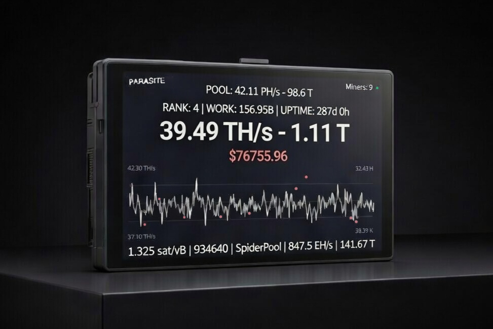
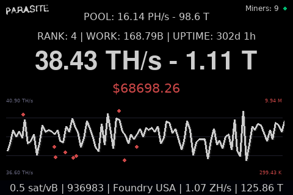
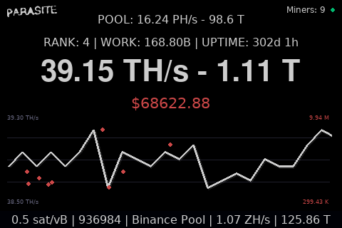
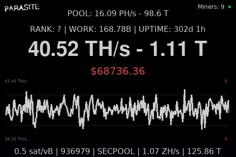
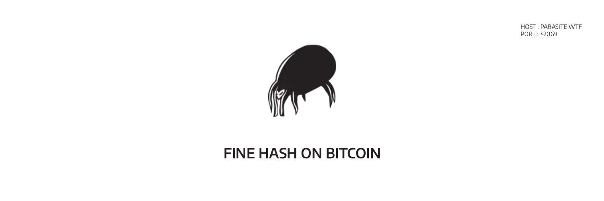

<div align="center">

# RPi Parasite Pool Dashboard Display
for Raspberry Pi TFT/HDMI Displays

[](https://www.raspberrypi.com/)
[](https://www.python.org/)
[](https://www.pygame.org/)
[](https://opensource.org/licenses/MIT)



</div>

<br>

<p align="center">Your Parasite Pool stats, real-time BTC price, recent shares and network metrics, all in one dashboard.</p>

## Screenshots

<div align="center">
  <table style="width:100%; max-width:900px;">
    <tr>
      <td align="center">
        
      </td>
      <td align="center">
        
      </td>
      <td align="center">
        
      </td>
    </tr>
  </table>
</div>

## Table of Contents

- [Features](#features)
- [Hardware](#hardware)
- [System Prerequisites](#system-prerequisites)
- [Installation](#installation)
- [Project Structure](#project-structure)
- [Configuration Notes](#configuration-notes)
- [Troubleshooting](#troubleshooting)
- [License](#license)
- [Acknowledgments](#acknowledgments)
- [Recommended Reads](#recommended-reads)
- [Support The Project](#support-the-project)

## Features

### 📈 BTC Price Ticker (from Binance & Kraken)
- Real-time BTC/USD price via Binance WebSocket (primary source) + Kraken fallback
- 24h price change coloring (green/red)
- Automatic reconnection with exponential backoff

### ⛏️ Parasite Pool Stats (personal & pool-wide)
- **Personal stats** (public address on parasite.space recommended):
  - Your hashrate (TH/s)
  - Best share difficulty
  - Total work contributed
  - Uptime
  - Rank on leaderboard
  - Active workers count
  - Hashrate curve
  - Recent high-difficulty shares (up to 9) shown as red dots on the chart
 
- **Pool-wide stats**:
  - Total pool hashrate (PH/s)
  - Pool best difficulty

### 📊 Historical & Visualization
- Historical hashrate curve (configurable intervals: 5m/15m/30m/1h)
- Dynamic scaling of Y-axis based on available data

### 🌐 Bitcoin Network Stats (from mempool.space)
- Recommended fees (sat/vB)
- Current block height
- Latest block mining pool
- Network hashrate
- Network difficulty

### ⚙️ UX / Performance / Config
- Low CPU usage: software rendering, static background, 12 FPS cap (configurable)
- Global connection/WiFi status indicator (green/orange/red circle)
- Stale data warnings (orange after 60s, red if no connection)
- Fully configurable via `config.json` (FPS, timeouts, historical interval, API base, etc.)
- Native 480×320 for 3.5" TFT + auto-scaling (with preserved aspect ratio) on HDMI displays
- Rotating logs to `./logs/app.log`
- Thread-safe data handling and error recovery

Perfect for an always-on Parasite Pool dashboard running on a Raspberry Pi 3B+, 4, or 5 with a TFT or HDMI display.

## Hardware

Developed and tested with:
  - Raspberry Pi 3B+, 4, 5
  - Waveshare 3.5" TFT touchscreen (480×320, XPT2046 controller)
  - HDMI monitors (auto-scaled with preserved aspect ratio)

## System Prerequisites

- Make sure `/boot/firmware/config.txt` has `dtoverlay=vc4-kms-v3d` enabled.

Before installing the Python dependencies, verify that you have the necessary system packages for Pygame and graphical support.

Run the following command:

```bash
sudo apt update && sudo apt install python3-venv python3-pygame libsdl2-dev libegl-dev
```

Additionally, add the user to the video and input groups to avoid permission issues with the framebuffer:

```bash
sudo usermod -aG video,input $USER
```

Log out and log back in (or reboot) for the group changes to apply.

## Installation

- Before installation, make sure your miner(s) are connected to the [Parasite Pool](https://parasite.space) (`parasite.wtf:42069`)

1. Clone the repository:

```bash
git clone https://github.com/DozNot/rpi-parasite-pool-dashboard-display.git
cd rpi-parasite-pool-dashboard-display
```

2. Create and activate a virtual environment (recommended):

**Important**: Use the system-provided `python3-pygame` package (from apt) for best compatibility with Raspberry Pi's kmsdrm driver.

```bash
python3 -m venv --system-site-packages venv
source venv/bin/activate
```
Why `--system-site-packages`?

→ This allows the `venv` to use the optimized system `pygame` while keeping other dependencies isolated.

3. Install dependencies:

```bash
python3 -m pip install -r requirements.txt
```

4. Copy and edit the configuration file:

```bash
cp config.example.json config.json
nano config.json
```
- Example config.json:
```json
{
  "btc_address": "YOUR BITCOIN ADDRESS FOR PARASITE",
  "logo_path": "logos/parasite-white.png",
  "fps": 12,
  "dim_alpha": 50,
  "data_timeout_sec": 300,
  "stale_warn_sec": 60,
  "mempool_poll_interval": 25,
  "parasite_poll_interval": 4,
  "wifi_check_interval": 12,
  "historical_interval": "5m",
  "total_work_cache_min": 140,
  "total_work_cache_max": 300,
  "parasite_api_base": "https://parasite.space/api"
}
```
→ Set `"btc_address"` with your real Bitcoin address used for Parasite Pool

→ Tweak FPS, intervals, etc. as desired

5. Run the application:

```bash
python3 app.py
```
- Then make it start automatically at boot (systemd, crontab @reboot, etc.) 
- Recommended for a dedicated dashboard

## Project Structure
```bash
rpi-parasite-pool-dashboard-display/
├── app.py                  # Main entry point
├── config.json             # User configuration
├── config.example.json     # Template: copy to config.json and edit
├── LICENSE                 # Project license
├── requirements.txt        # Python dependencies
├── assets/                 # Images used in README
│   ├── demo.png            # Demo screenshot
│   ├── btc-qr.png          # BTC QR
│   ├── xmr-qr.png          # XMR QR
│   └── ...            
├── logos/                  # Parasite logo
│   └── parasite-white.png
├── logs/
│   └── app.log             # Rotating log file (INFO/WARNING/ERROR)
├── src/                    # Source code modules
│   ├── __init__.py
│   ├── constants.py        # Constant values and settings
│   ├── data.py             # Shared application state and data structures
│   ├── helpers.py          # Utility functions
│   ├── mempool.py          # Mempool/BTC network data
│   ├── parasite.py         # Parasite Pool polling
│   ├── rendering.py        # Display rendering and drawing logic
│   └── websockets.py       # WebSocket connections for prices
├── README.md               # Project documentation and setup guide
└── SECURITY.md             # Security Policy
```

## Configuration Notes

All paths are relative to the project root.

- `btc_address`: Your Bitcoin address for Parasite Pool stats.
- `logo_path`: Path to the Parasite logo.
- `fps`: Display refresh rate in frames per second.
- `dim_alpha`: Transparency level for the dimming/fade effect (0-255).
- `data_timeout_sec`: Timeout in seconds for data freshness.
- `stale_warn_sec`: Stale data warning threshold.
- `mempool_poll_interval`: Mempool polling interval.
- `parasite_poll_interval`: Parasite Pool polling interval.
- `wifi_check_interval`: WiFi check interval.
- `historical_interval`: Historical hashrate data interval ("5m", "15m", "30m", "1h").
- `total_work_cache_min`/`total_work_cache_max`: Total work cache range.
- `parasite_api_base`: Parasite Pool API base URL.

→ If `config.json` is missing, invalid, or corrupted, the program falls back to defaults (no BTC address → no personal stats).

## Troubleshooting

- No display → Check environment variables in `app.py`.
- No price → Internet connection required (Binance & Kraken APIs).
- Pool stats not updating → Verify your `btc_address`, internet, API status.
- Personal stats missing (rank, red dots...) → Happens if your address is private on parasite.space.
- High CPU → Lower FPS in `config.json` (default=12).
- Stale data → Orange color if >60s without update, red if no WiFi.

→ Logs are written to `./logs/app.log`.

## License

MIT License – see LICENSE file

## Acknowledgments

- Uses data from the parasite.space API
- Price tickers from the Binance and Kraken public APIs
- Network statistics from mempool.space

Special thanks to:
- zkSHARK
- Parasite Pool
- Ordinal Maxi Biz (OMB)

<div align="center">
  
<h1>PARASITE POOL</h1>
<p>Open-Source Bitcoin Mining Pool</p><br>

<br><br>

<p><strong>Stratum</strong>: parasite.wtf</p>
<p><strong>Port</strong>: 42069</p>

</div>

## Recommended Reads

The following articles by [zkSHARK](https://zkshark.substack.com/), founder of [ORDINAL MAXI BIZ \(OMB\)](https://magiceden.io/ordinals/marketplace/omb) and [Parasite Pool](https://parasite.space), explore mining decentralization, reducing reliance on dominant pools, empowering home miners, and preserving [Bitcoin](https://bitcoin.org)’s distributed ethos.

- **[Parasite Pool: Igniting the Mining Insurrection](https://zkshark.substack.com/p/parasite-pool-igniting-the-mining)**  
  An in-depth explanation of Parasite Pool’s zero-fee model, Lightning payouts, coinbase construction mechanics, and its approach to improving mining decentralization.

- **[The Revolution Will Not Be Centralized: OMB x Bitaxe](https://zkshark.substack.com/p/the-revolution-will-not-be-centralized)**  
  A look at open-source home mining hardware such as [Bitaxe](https://bitaxe.org/), the Ordinal Maxi Biz ethos, and the broader movement toward accessible, self-sovereign mining infrastructure.

- **[Ordinals, Inscriptions, and Rare Sats - Oh my!](https://zkshark.substack.com/p/ordinals-inscriptions-and-rare-sats)**  
  An early perspective on [Ordinals](https://github.com/ordinals/ord) and emerging Bitcoin-native experimentation, reflecting a culture of innovation, self-sovereignty, and independent participation.

## Support the Project

If you find this project useful, consider supporting its development with a small donation. Thank you!

<br>

<div align="center">
  
<table>
  <tr>
    <th align="center"><strong style="font-size: 1.3em;">[ BITCOIN ]</strong></th>
    <th align="center"><strong style="font-size: 1.3em;">[ MONERO ]</strong></th>
  </tr>
  <tr>
    <td align="center">
      <br><br><br>
    </td>
    <td align="center">
      <br><br><br>
    </td>
  </tr>
</table>

</div>

<div>
  <p>Bitcoin:</p>
  
```bash
bc1qkaqaxqheejuddrp5604wy592k423vjmk3uu35l
```
</div>

<div>
<p>Monero:</p>

```bash
457KEpgmvXJgNSnrkVs2poFPCVNXxPoqBAnxjSC1T9C3QUSSxXMR3iLFx1LtPc77oUAmoVwHgrh7KGzFugVpc1RCJ9nR3PS
```
</div>
<br>
<div align="center">


<br>Built for independent miners.<br>
Built for decentralized infrastructure.

<em>"THE REVOLUTION WILL NOT BE CENTRALIZED"</em> — zkSHARK

</div>
